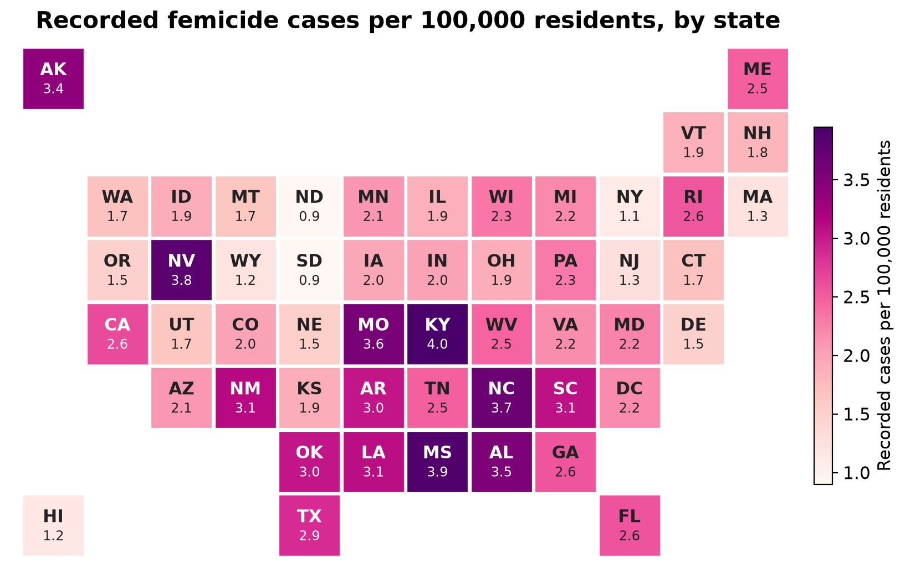
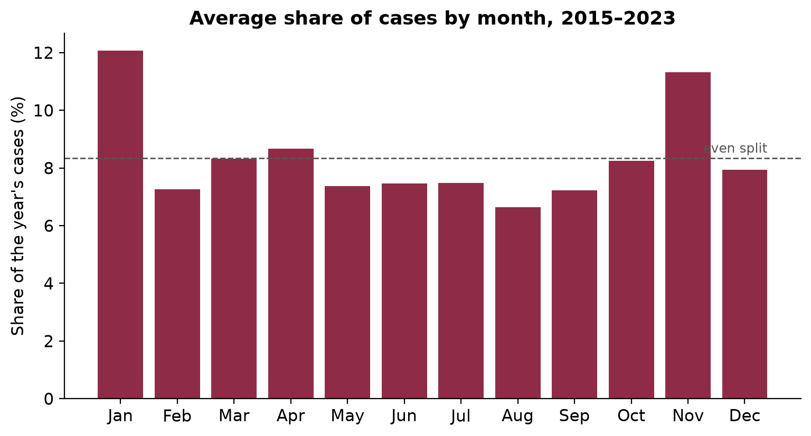
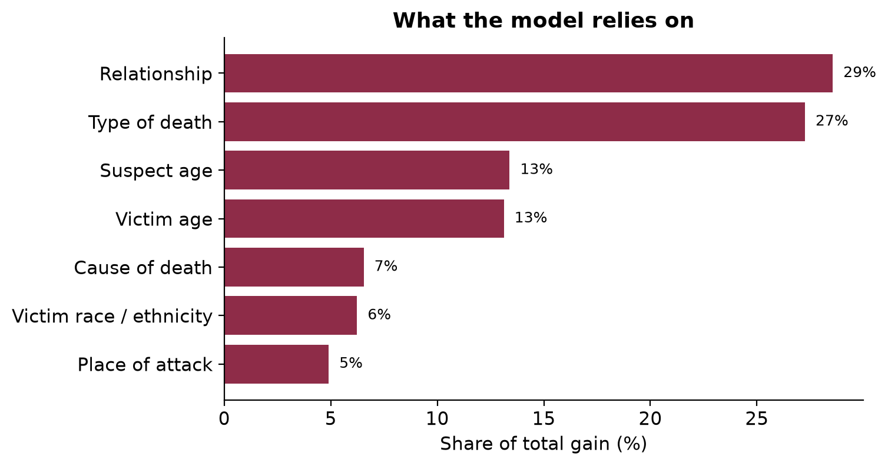

# Femicide in the United States

An analysis of nearly 8,000 recorded femicide cases (the gender-based killing of women) across the U.S.: where cases are
concentrated relative to population, how they vary over time, and which case attributes distinguish multi-victim
incidents, using an XGBoost classifier.

Data: [Women Count USA](https://womencountusa.org), a public database of femicide cases from 2015 to 2024.



## Key findings

**1. Per-capita rates tell a different story than raw counts.** California, Texas and Florida record the most cases,
but counts track population closely (r = 0.95). Per resident, the highest rates are in **Kentucky, Mississippi, Nevada,
North Carolina and Missouri** (3.6–4.0 recorded cases per 100,000 residents), roughly four times the lowest states.
→ [`01_geospatial.ipynb`](notebooks/01_geospatial.ipynb)

**2. January and November stand out.** After correcting for year-only placeholder dates and for coverage that differs
from year to year, January (12%) and November (11%) carry noticeably more than an even one-twelfth share of each
year's cases. → [`02_temporal_trends.ipynb`](notebooks/02_temporal_trends.ipynb)

<p align="center"></p>

**3. Relationship and type of death identify multi-victim cases.** About a third of labeled cases involve more than
one victim. An XGBoost model separates them from single-victim cases with **81% accuracy and 0.84 ROC AUC**
(cross-validated, vs. a 68% majority-class baseline). Who the suspect was (husband, boyfriend, family member,
stranger) and how the incident ended (familicide, murder-suicide) carry the most weight, followed by victim and
suspect age. Even without type of death, the model reaches 0.81 AUC. → [`03_risk_factors.ipynb`](notebooks/03_risk_factors.ipynb)

<p align="center"></p>

## Methods

| Analysis | Approach |
|---|---|
| Geospatial | Cases per state joined to 2020 Census population; per-capita rates shown on a tile-grid map |
| Temporal | Monthly counts with a 12-month rolling average; seasonality measured as each month's share of its year's cases, which removes year-to-year coverage differences |
| Risk factors | One-hot encoded case attributes plus ages; gradient-boosted trees (XGBoost) evaluated with 5-fold stratified cross-validation; importance measured as total gain grouped by attribute |

**Data handling.** Names, photos and free-text case details are dropped as soon as the data is loaded
([`femicide.py`](notebooks/femicide.py)), so no identifying information appears in any notebook output. About 560
cases known only by year are recorded as December 31; they are excluded from the monthly analysis.

**Limitations.** The database's coverage varies by year and state, so these figures describe *recorded* cases rather
than true incidence, and changes in yearly totals mostly reflect collection effort. The multi-victim label is only
filled in for some years. All findings are associations, not causes.

## Repository

```
notebooks/
  femicide.py               loading, de-identification and cleaning
  01_geospatial.ipynb
  02_temporal_trends.ipynb
  03_risk_factors.ipynb
figures/                    charts generated by the notebooks
data/state_population.csv   2020 Census population by state
```

## Reproducing

Case data is not included because it identifies victims. Download the yearly exports from
[womencountusa.org](https://womencountusa.org) as `2015.csv` … `2024.csv` into `data/raw/` (or point the
`FEMICIDE_DATA` environment variable at their folder), then:

```bash
pip install -r requirements.txt
jupyter notebook notebooks/
```

## Next steps

- County-level rates to find local hotspots that state totals hide
- Adding socioeconomic indicators, firearm laws and the availability of domestic-violence services
